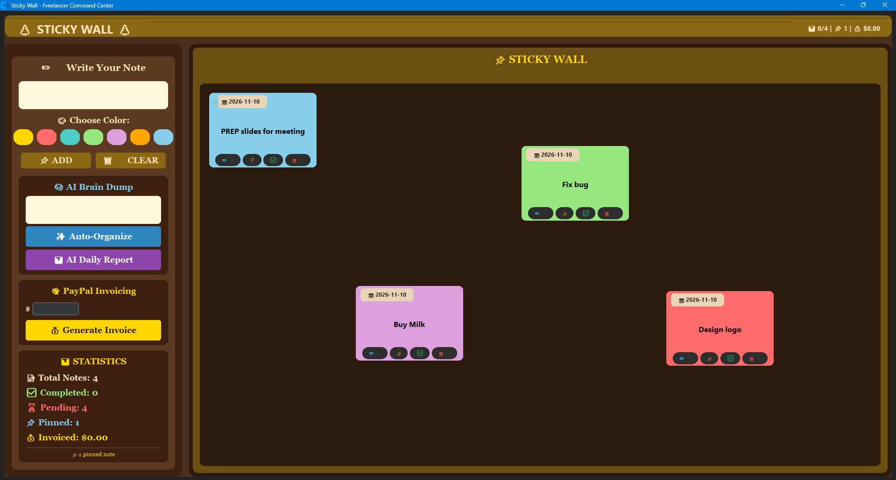
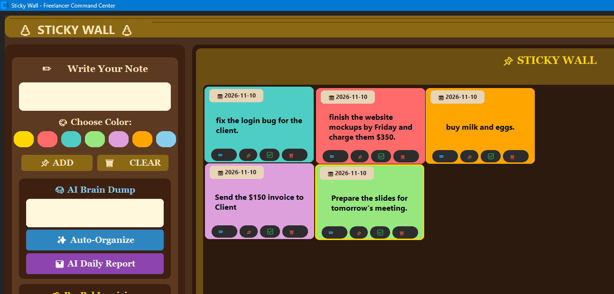
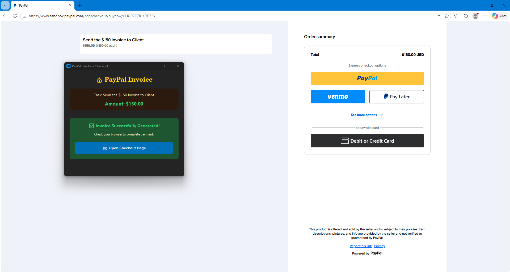

# 🍞 Sticky Wall - Freelancer Command Center

A desktop productivity app built with Python and CustomTkinter that helps freelancers and students organize tasks using Google Gemini AI, and generate real invoices using the PayPal Developer Sandbox.

## 🚀 Features
- **🧠 AI Brain Dump:** Type a messy paragraph. The app uses Google Gemini AI to parse the text, separate it into individual tasks, color-code them by category (Work, Urgent, Personal), and extract dollar amounts.
- **💸 PayPal Invoicing:** Select a task, enter an amount, and click "Generate Invoice". The app uses the PayPal Sandbox API to open a real checkout page in your browser.
- **📊 AI Daily Report:** Get an AI-generated summary of the tasks you completed that day.
- **📌 Manual Notes:** Create, edit, drag-and-drop, pin, complete, and delete notes on a beautiful wooden board theme.
- **📈 Real-time Statistics:** Tracks your total notes, completed tasks, pending tasks, pinned notes, and total amount invoiced.

## 📸 Screenshots

### 1. The Wooden Board & Sidebar


### 2. AI Brain Dump in Action


### 3. PayPal Sandbox Invoicing


## 🛠️ Tech Stack
- **Language:** Python 3.x
- **Frontend/UI:** CustomTkinter
- **AI Engine:** Google Gemini API (`google-genai`)
- **Payments:** PayPal Developer Sandbox (REST API)
- **Data Storage:** Local JSON

## ⚙️ Setup Instructions

1. **Clone the repository:**
   ```bash
   git clone https://github.com/Areeba0709/sticky-wall-freelancer.git
   cd sticky-wall-freelancer
2. **Install the requied dependencies:**
    ```bash
    pip install -r requirements.txt
3. **Set up your API Keys:**
    Create a new config.py file in the root directory.
   · Add your Google Gemini API key:
     ```python
      GEMINI_API_KEY = "your_api_key_here"
4.  **Run the application:**
      ```bash      
       python sticky_wall.py
      
**Important Note:**

This project uses the PayPal Sandbox Environment. No real money is processed. The API keys used for the demo video have been removed for security. You must supply your own Gemini API key to use the AI features.

**📄 License**

This project is licensed under the MIT License - see the LICENSE file for details.

```
